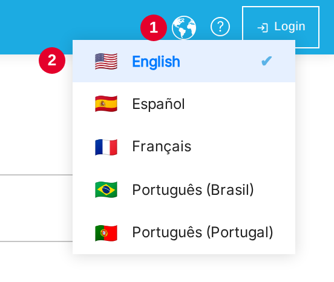

# Changing the Language

GeoSight's interface is available in the following languages:

| Language | Shown in the selector as |
|---|---|
| English | 🇺🇸 English |
| Spanish | 🇪🇸 Español |
| French | 🇫🇷 Français |
| Portuguese (Brazil) | 🇧🇷 Português (Brasil) |
| Portuguese (Portugal) | 🇵🇹 Português (Portugal) |

English is the default.

## Selecting a Language

{: style="width:360px"}

Click the 1️⃣ `Globe` icon in the top bar to open the 2️⃣ `Language list`, then select a language. The current language is marked with ✔. In the admin pages, the same `Globe` icon is in the side navigation.

The page reloads in the selected language.

## The Language in the Address

The selected language is part of the page address, for example `https://<your-geosight>/fr-fr/` for French or `https://<your-geosight>/pt-br/` for Portuguese (Brazil). This means that:

- a link you share opens in the language it was copied in,
- you can bookmark a page in a specific language,
- you can switch the language by changing that part of the address.

Only the interface is translated. Content created by users, such as project names, indicator names, descriptions and data, is shown as it was entered.
