# Chart Widgets

A chart widget shows the indicator data of a project as a chart in the widget panel of the dashboard. It uses the same
data settings as the other widgets (indicators, geographical units, date and aggregation), and adds a choice of chart
types: bars, lines, donuts, scatter plots, heatmaps, treemaps, gauges and KPI tiles.

Charts follow the map: by default they use the indicators and areas shown on the map, the dashboard date, and the
colours of the indicator's map style. Clicking an area in a chart selects it on the map.

## Creating a chart widget

1. Open the project in the project editor and go to the **Widgets** tab.
2. Click **Add Widget** and pick a chart type from the **Widget type** tiles (see [Chart types](#chart-types)).
3. Give the widget a **name** (required) and, optionally, a **description**.
4. Set the **Number format** and the options of the chart type.
5. Set the data in the middle column: **Series**, **Sort by**, **Indicators**, **Geographical units** and
   **Date/Time**. The editor shows only the settings that the chosen chart type uses.
6. Check the **Preview** in the right-hand column: it updates as you change the settings.
7. Click **Apply** (lower right corner), then **Save** the project.

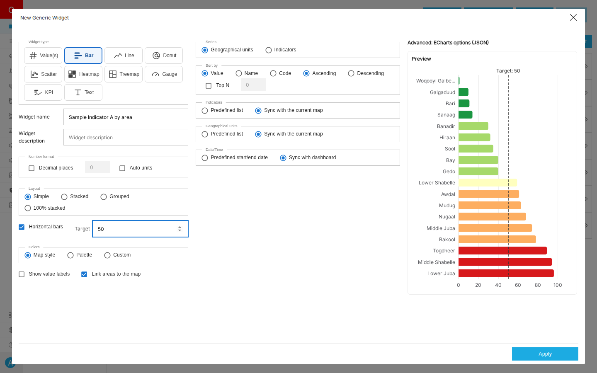

The **Apply** button stays in the lower right corner; each column scrolls on its own, so the preview stays in view.
On a smaller screen the editor shows two columns, with the data settings under the preview. On a phone or a narrow
window, it shows one column: the preview first, then the chart settings and the data settings, with **Apply** at the
bottom of the screen.

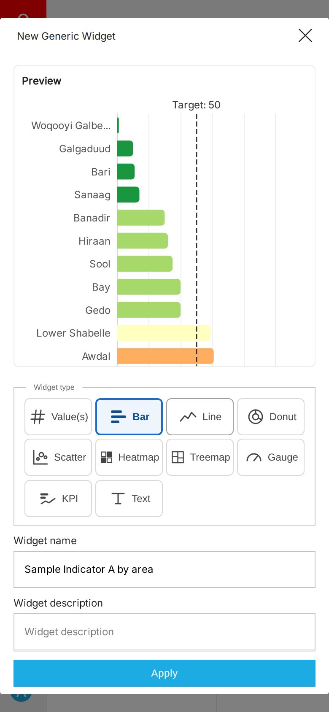{ width="300" }

## Chart types

| Chart type | Shows | Options |
|---|---|---|
| **Bar** | The latest value of each area or indicator. | **Layout**: Simple, Stacked, Grouped or 100% stacked; **Horizontal bars**; **Target** (a dashed line). |
| **Line** | Values over time, one line per area or indicator. | **Fill area**; **Period**: each date, month or year. |
| **Donut** | The share of each area or indicator in the total (up to 11 slices in the order of **Sort by**, the smallest as "Other"). | |
| **Scatter** | One point per area: one indicator on the X axis, another on the Y axis, optionally a third as the point size. | **X axis**, **Y axis**, **Point size** (type a name or short code to find an indicator); **Pulse selected area**. |
| **Heatmap** | Values over time: one row per area or indicator, one column per period. | **Period**. |
| **Treemap** | The latest value of each area or indicator as a rectangle sized by the value. | |
| **Gauge** | One total value on a scale. | **Minimum**, **Maximum** (empty = automatic), **Target**. |
| **KPI** | One total value, its change since the previous date, and a small trend line. | **Period**. |

**Stacked** and **grouped** bars split each bar by the other dimension: by indicator when the series are geographical
units, and by area when the series are indicators. Use them to compare several indicators per area.

| Bar with a target | Stacked bars | Line |
|---|---|---|
| 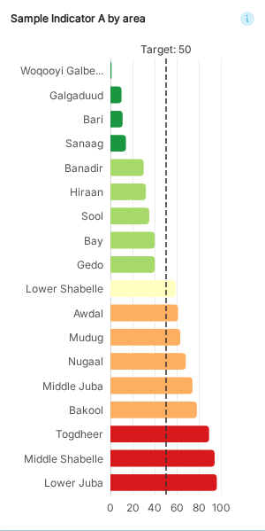 | 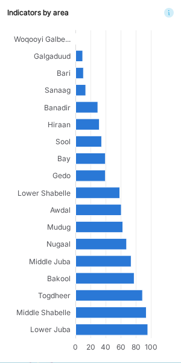 | 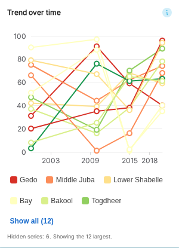 |

| Donut | Scatter | Heatmap |
|---|---|---|
| 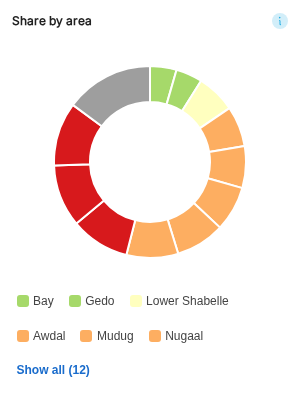 | 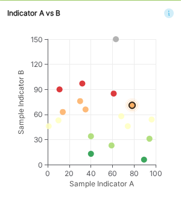 | 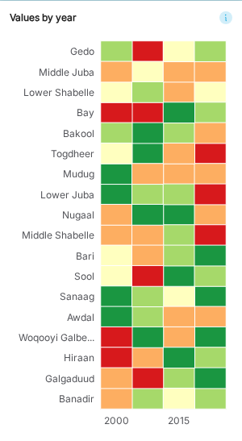 |

| Gauge | KPI |
|---|---|
| 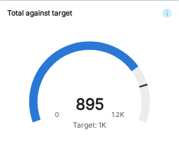 | 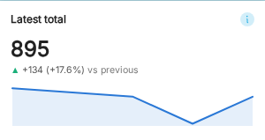 |

### Settings for all chart types

- **Colors**:
    - **Map style** (default) colours areas the way the map does, from the indicator's style.
    - **Palette** uses a colour palette, picked next to it, one colour per bar, slice or line.
    - **Custom** uses a colour per item, set in a **Predefined list**: the list gets a **Color** column, and each new
      item starts with the next palette colour. The list that gets the colours is the one the chart draws as
      separate colours:

        | Chart | Colours per |
        |---|---|
        | Simple bar, line, donut, treemap | the **Series**: indicators or geographical units |
        | Stacked, grouped and 100% stacked bars | the other dimension: indicators when the series are geographical units, areas when the series are indicators |
        | Scatter | geographical units |

        The text under **Colors** says which list to use.

    Line charts have no map style; their default is the palette. The preview shows every change straight away.
- **Show value labels**: writes the values on the chart.
- **Area labels** (shown when **Show value labels** is on, for charts that show areas): label the areas with their
  **Name** (default) or their **Code**.
- **Number format**: **Decimal places** and **Auto units** (1.5K, 2.3M) apply to every value the chart shows: value
  labels, tooltips, targets, the gauge and the KPI, whether the values are aggregated or not. With **Decimal places**
  on, values show exactly that many decimals (79 with 2 decimals shows 79.00). With it off, values keep up to two
  decimals (0.45 stays 0.45). The axes use the same format, without the extra zeros.
- **Link areas to the map** (on by default): clicking an area in the chart selects it on the map. Shown only for
  charts that show areas.
- **Advanced: ECharts options (JSON)** (above the preview): for advanced users. The JSON is applied on top of the chart settings, using the
  [Apache ECharts option format](https://echarts.apache.org/en/option.html). Only plain JSON values are accepted:
  functions, formatters, links and CSS styles are ignored. If the JSON is not valid, the chart keeps the last valid
  options and the editor shows an error.

### Which data settings each chart type uses

Line charts and stacked or grouped bars show up to 12 series; when there are more, the 12 largest are drawn and the
chart says how many are hidden.

| Setting | Bar, Donut, Treemap | Line, Heatmap | Scatter | Gauge, KPI |
|---|---|---|---|---|
| Aggregation | with **Series** = Indicators | with **Series** = Indicators, or a monthly or yearly **Period** | no | yes |
| Series | yes | yes | no | no |
| Sort by (order, Top N) | yes | no (time order) | no | no |
| Indicators | yes | yes | no (X, Y and size instead) | yes |
| Geographical units | yes | yes | yes | yes |
| Date/Time | yes | yes | yes | yes |

**Aggregation** (below the chart options, so the chart types never move) only appears when the chart combines several
values into one: the values of several areas (series by
indicator, gauge, KPI) or of several dates in a month or year. A chart with one value per area shows that value.

**Date/Time**: with **Sync with dashboard**, charts follow the dashboard's time slider (including "Show last known value
in range"); with **Predefined start/end date** they always use those dates. Bars, donuts, treemaps, scatters and gauges
show the latest value in the range; lines, heatmaps and KPIs show every date in it, grouped by the **Period**. When the
range has no data, the chart says "No data found".

## Using chart widgets on the dashboard

### The info popup

Hover over (or tap) the **i** icon next to the widget name to see how the chart is set up: the chart type and layout,
its own settings (axes, period, target), and the data settings it uses.

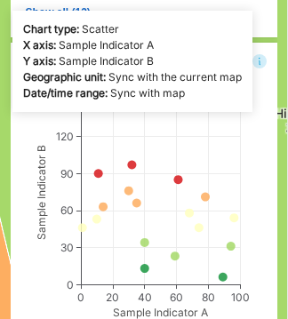{ width="320" }

### The legend

Charts with several series or slices (stacked and grouped bars, lines, donuts) have a legend below the chart. It shows
the first six entries; **Show all** lists every entry and **Show less** folds the list again. Click an entry to hide
or show its series or slice: hidden entries are grey and struck through.

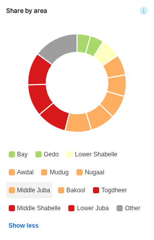{ width="300" }

### Selecting an area on the map

When **Link areas to the map** is on, click a bar, slice, rectangle, point or cell, or the name of an area on the axis.
The map zooms to that area and outlines it in red, and the chart outlines the area and shows its name in bold. Click
the same area again to clear the selection. In a scatter chart with **Pulse selected area** on, the
selected area's point pulses.

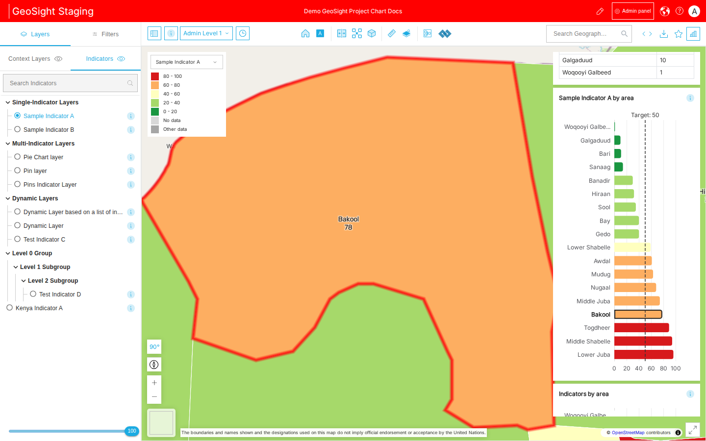

### Several indicators on the map

When the widget's indicators are synced with the map and the map shows more than one indicator (for example a
multi-indicator layer, or two layers side by side):

- Charts that can show several indicators draw all of them: stacked, grouped and 100% stacked bars, and every chart with
  **Series** set to **Indicators**.
- Charts that show one indicator at a time (a simple bar, donut, treemap, heatmap or line by area, a gauge or a KPI) get
  an **Indicator** list above the chart. Pick the indicator to show; the values of different indicators are never
  added up.

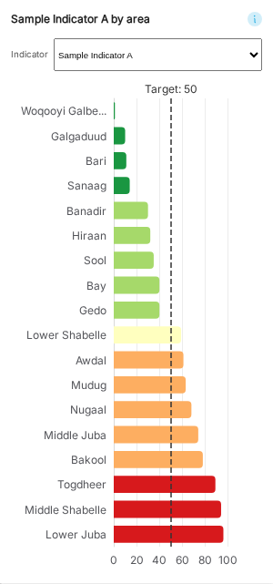{ width="300" }

### On phones

Chart widgets are in the **Widgets** panel (the chart icon in the bottom bar). Charts use the full width of the screen;
tap a bar or point to see its value.

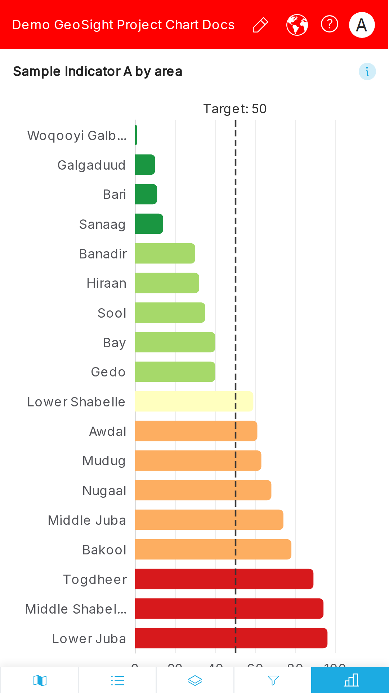{ width="300" }
