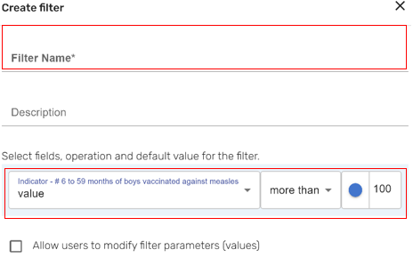
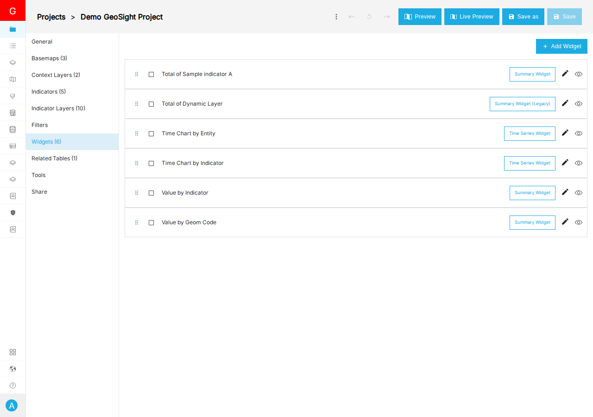
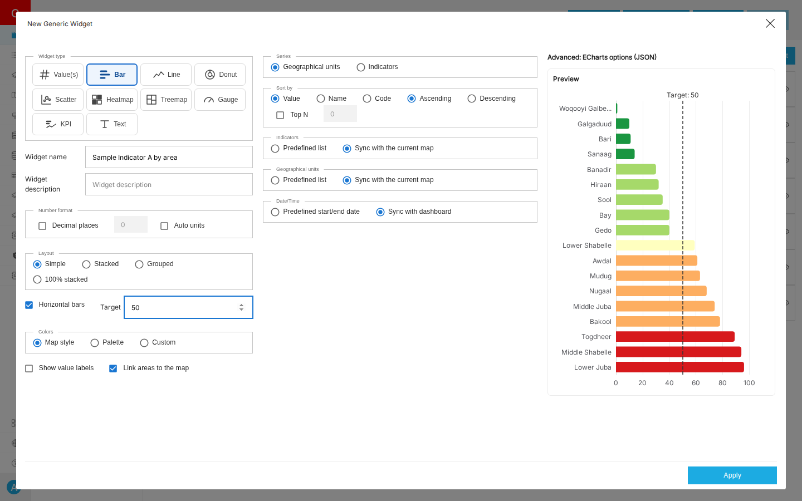
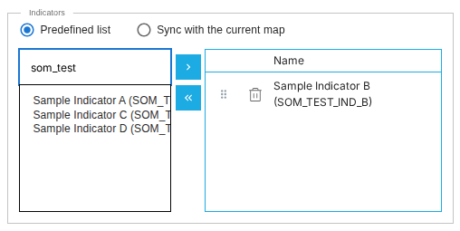
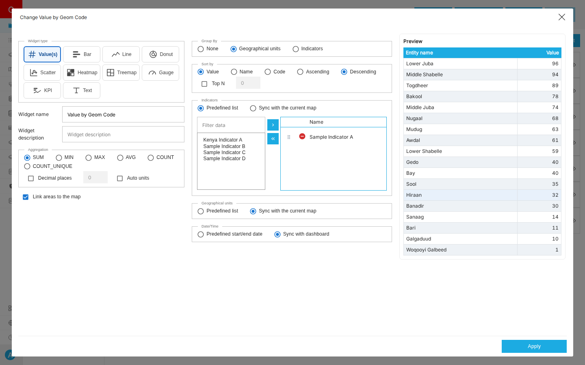
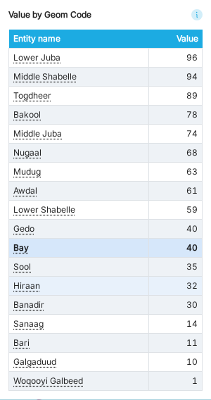
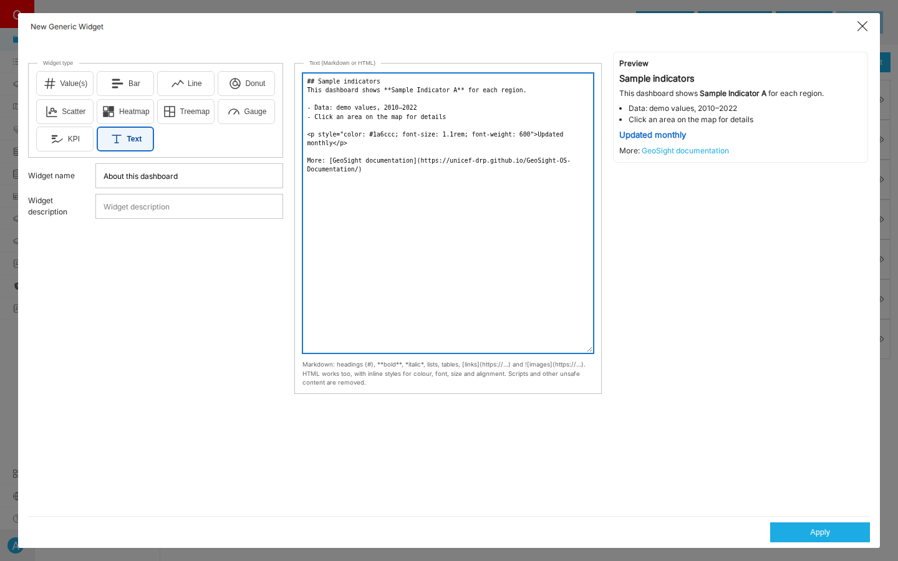
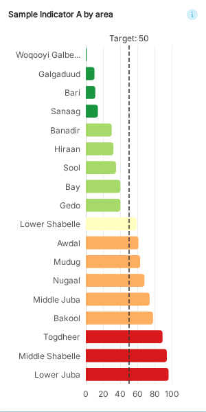

# Widgets and Filters

Widgets & filters are some of the most powerful tools on GeoSight as they allow for the multi-variate analysis of humanitarian indicators across time and space. They can highlight areas with specific needs, as well as provide various graphs that help to improve the users understanding and comprehension of the data.

## Filters

Filters are a valuable tool that administrators can enable to allow front-end users to only display districts that meet a certain threshold or criteria of an indicator’s values.

### Creating Filters

1. Optionally complete the Filters tab in _Projects_ to allow users to identify and isolate specific administrative areas based on the desired values of an indicator.

    a.	You can create filters by selecting the plus button on the right. 

    b.	Define the operation for the filter

    c.	Connect filters (optional) 

        i.	The AND/OR operation allows you to design filters to identify areas that meet multiple conditions at once, or one or the other. 



## Widgets

Widgets show the project's data in the widget panel of the dashboard, next to the map: totals, tables of values, charts
and text.

### Managing widgets

Open the project in the project editor and go to the **Widgets** tab. It lists the widgets of the project with their
type.

- **Add Widget** opens the widget editor for a new widget.
- The **pencil** icon opens a widget in the editor.
- The **eye** icon shows or hides the widget on the dashboard.
- Drag a widget by its handle (the dots on the left) to change the order.

Save the project to keep the changes. Widgets created with older versions of GeoSight show "(Legacy)" next to their
type; they keep working and can still be edited.



### Creating widgets

1. Click **Add Widget**.
2. Pick the widget type from the **Widget type** tiles: **Value(s)**, one of the eight chart types (**Bar**, **Line**,
   **Donut**, **Scatter**, **Heatmap**, **Treemap**, **Gauge**, **KPI**) or **Text**.
3. Enter a **Widget name** (required) and, optionally, a **Widget description**.
4. Set what the widget shows (see the widget types below). Switching to another tile keeps the name, the description
   and the data settings.
5. Click **Apply**, then **Save** the project.

All widget editors have the same layout, in a window of the same size: the widget type and the general settings on the
left, the data settings in the middle and a live **Preview** on the right that updates as you change the settings. Each
column scrolls on its own, and **Apply** stays in the lower right corner. On a smaller screen the preview moves above
the data settings; on a phone everything is in one column, with the preview first.



The data settings are the same for the value(s) and the charts:

- **Aggregation** (value(s), and charts that combine values): how the values are combined: SUM, MIN, MAX, AVG, COUNT or
  COUNT_UNIQUE. **Decimal places** and **Auto units** (for example 1.5M instead of 1,500,000) set how the numbers are
  shown (for charts, in their own **Number format** section): with **Decimal places** on, every number shows exactly
  that many decimals, in the value(s), the tables and the charts.
- **Indicators**: a **Predefined list** of indicators, or **Sync with the current map** to use the indicators of the
  layers shown on the map.
- **Geographical units**: a **Predefined list** of areas, or **Sync with the current map** to use the areas on the map
  (including the ones left by the filters).

In a **Predefined list**, the left-hand list shows each indicator with its short code in brackets, for example
"Sample Indicator B (SOM_TEST_IND_B)", and each area with its code. Type in the search box to filter by name or code
(upper or lower case). To add items, select one or more and click the arrow, or double-click an item.

{ width="500" }
- **Date/Time**: **Sync with dashboard** to follow the dashboard date, or a **Predefined start/end date**.

#### Value(s) widgets

A value(s) widget (called *Summary widget* in the Widgets tab) shows one value, for example the total of an indicator.
With **Group By** set to **Geographical units** or **Indicators**, it shows a table with one value per area or per
indicator. **Sort by** orders the table by value, name or code, and **Top N** keeps only the first values.

With **Group By** set to **Geographical units**, **Link areas to the map** (on by default) makes the area names in the
table clickable: a click zooms the map to the area and outlines it, and highlights its row; a second click clears it.
Every second row of the table is shaded, and the row under the pointer is highlighted.



{ width="300" }

#### Text widgets

A text widget shows your own text: a title and introduction for the dashboard, notes on the data, links to reports.
Write it in the **Text** field in [Markdown](https://www.markdownguide.org/basic-syntax/): headings (`#`), **bold**,
*italic*, lists, tables, links and images. HTML works too, with inline styles for colour, background, font, size,
weight and alignment, for example:

```html
<p style="color: #1a6ccc; font-size: 1.1rem; font-weight: 600">Updated monthly</p>
```

Links open in a new tab. Links and images must use `https://` (or `http://`); scripts, event handlers and other unsafe
content are removed, and styles that are not in the list above are ignored. An image needs the address of the image
file itself (ending in `.png`, `.jpg`, `.svg`…), not of a web page that shows it; share links of file-hosting services
(Google Drive, OneDrive, Dropbox) usually point to a page, and some websites refuse to show their images on other
sites.



#### Time series widgets

New time series are made with the **Line** chart: it shows values over time, one line per area or indicator, by date,
month or year, follows the time slider, and lets viewers pick the indicator when several are shown. Time series widgets
created before keep working on the dashboard and can still be edited; they show a **Time series** tile in the editor.

On the dashboard, time series show the date range selected on the time slider when **Date/Time** is **Sync with
dashboard**, and the dates set in the widget when it is **Predefined start/end date** (see
[Date and Time](../manual/date-and-time.md)).

#### Chart widgets

A chart widget shows the data as a bar, line, donut, scatter, heatmap, treemap, gauge or KPI chart. Clicking an area in
a chart selects it on the map. See [Chart Widgets](chart-widgets.md).

{ width="300" }
