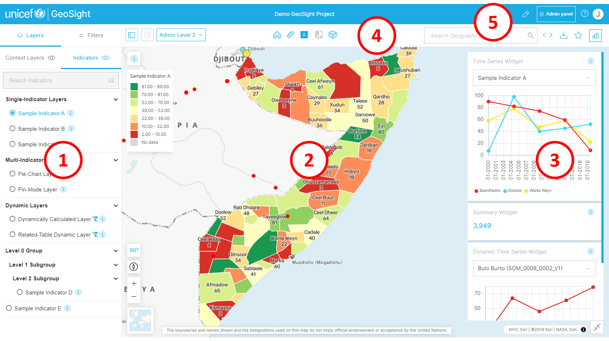
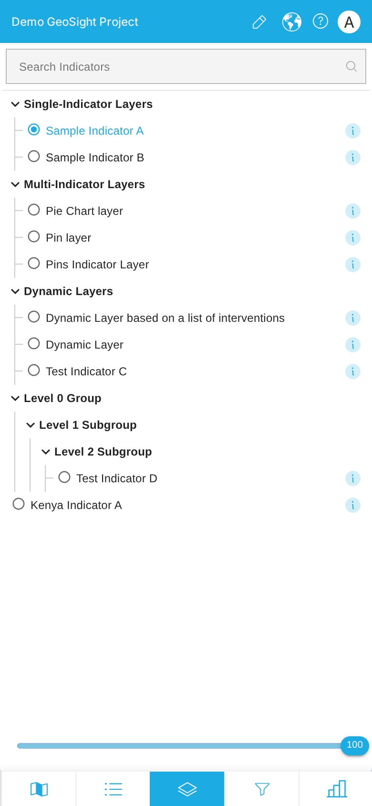

# The Dashboard page

The Dashboard page is where users can interact with the final GeoSight dashboards. The Dashboard page consists of the following key elements:

1.	Left panel - contains a list of Indicator Layers, Context Layers and Filters.
2.	Map window - is used to visualize Indicator Layers, Context Layers and Basemaps along with map legend, map disclaimer and Time Slider.
3.	Widget panel - shows widgets that display summary data.
4.	Map toolbar - contains a number of tools for interacting with the map and side panels. Users can change Date/Time settings, admin level, switch between 2D/3D modes etc. The **Back to Home** button (house icon) returns the map to the default extent of the project.
5.	Top panel - depending on privileges users can enter the Edit mode, open Admin panel, open the Help Center or access their Profile page.
6.	Basemaps - provide underlaying views that include road maps and satellite data for the indicators to be superimposed upon.

## On phones and small screens

On screens up to 1000 px wide, the dashboard shows one view at a time. Use the tabs at the bottom of the screen to switch between them:

| Tab | Shows |
|---|---|
| Map | The map, with the map toolbar and, when it is open, the [time slider](date-and-time.md#on-phones-and-small-screens). |
| Context layers | The list of context layers (only if the project has context layers). |
| Indicators | The list of indicator layers (only if the project has indicator layers). |
| Filters | The filters (only if the project has filters). |
| Widgets | The widget panel. |

The tabs work the same in every interface language.

