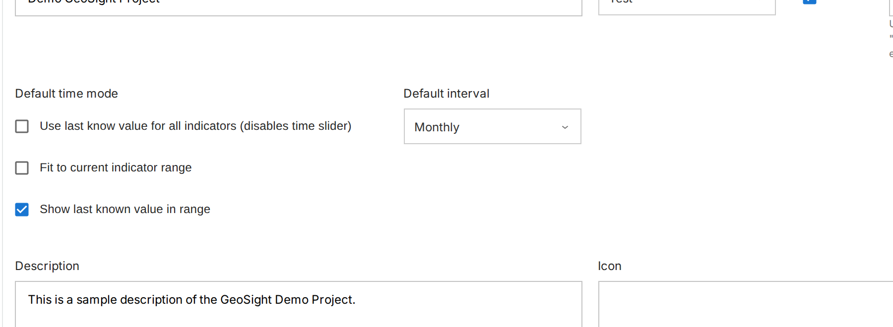
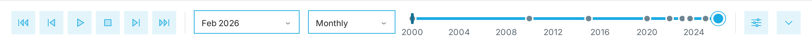
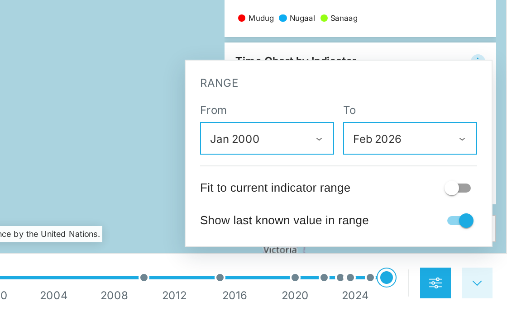
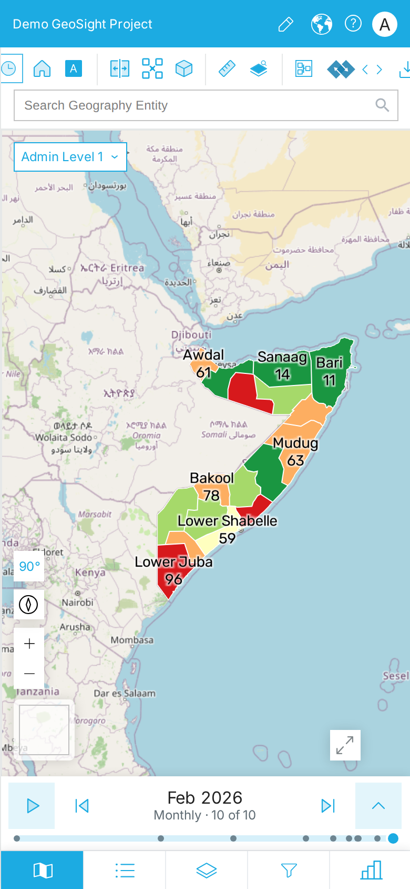
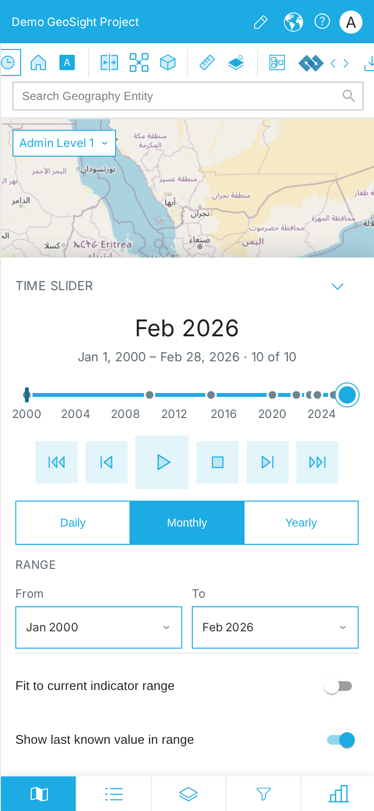

# Date and Time
Taking advantage of the date and time function in GeoSight allows users to utilize powerful analysis tools built into the program. From displaying historical data to highlighting the progression of indicator values through a time series widget, these tools can better inform users and allow them to understand their data beyond their physical locations.

Date-Time is an important dataset attribute that can be visualized and analyzed within GeoSight in several ways through project-specific configurations.

1. Date-Time Slider
2. Time Series Widget

## Data Management of Date-Time Values

In GeoSight, data is imported and managed through three dimensions as the graphic above illustrates:

1. Geography/Location
2. Indicator
3. **Date-Time**

This management and storage of the date-time component enables these various analysis tools to work. By including this dimension with every import, every piece of data (a value attached to a sub-national administrative area) there is a date associated with it.

At the same time, when importing users are allowed to import multiple values across different periods, allowing for the easy streamlining of data management and the utilization of date-time-based tools.

See [Importing Data](https://unicef-drp.github.io/GeoSight-OS-Documentation/user/guide/importing_data/#long-format) for more details on how to configure date-time during the importing process.

## Project Date-Time Configurations

Within projects, users can configure various analysis tools to improve user comprehension of the datasets.

### Date-Time Slider

The Date-Time Slider allows users to see historical values for different indicators if this data has been previously imported. This is valuable because it allows for the visualization of data and enables users to observe visual changes in values over time.

#### Turning on the time slider

1. To activate the time slider, navigate to the **General** tab of the [project management back-end page](https://unicef-drp.github.io/GeoSight-OS-Documentation/user/guide/creating-projects/). Under **Default time mode** you will see the following:

2. When **Use last know value for all indicators (disables time slider)** is checked, the time slider is turned off and the map only displays the most recent data. Uncheck it to turn on the time slider.

3. _(optional)_ Check **Fit to current indicator range** so the time slider only offers the dates of the indicator layer that is currently selected, instead of the dates of all indicator layers in the project.

4. _(optional)_ Choose the **Default interval** (Daily, Monthly or Yearly).

5. _(optional)_ **Show last known value in range** is checked by default: for every area the map shows the most recent value between the start of the range and the selected date. Uncheck it to show only the values that fall inside the selected period.

These are the defaults that every visitor starts with. Visitors can change the interval and the two options on the dashboard, and the **Stop** button brings them back to these defaults.

#### Using the time slider

Open the time slider with the clock button in the map toolbar. It appears as a bar along the bottom of the map:

From left to right:

| Control | What it does |
|---|---|
| **First**, **Previous**, **Next**, **Last** | Jump to the first, previous, next or last date that has data. |
| **Play / Pause** | Steps through the dates automatically. While playing, the button shows a pause icon. |
| **Stop** | Stops playing and resets the time slider to the project's default time settings (interval, the two options, the full range and the latest date). |
| **Current period** (e.g. "Feb 2026") | The selected period. Open it to pick another date from the list. Hover over it to see the exact active window, e.g. "Jan 1, 2000 – Feb 28, 2026". |
| **Interval** | Daily, Monthly or Yearly. |
| **Track** | Every date with data is a dot. Drag the handle (it snaps to the nearest date) or click a dot. Dark brackets mark the start and end of the range; dates outside the range are shown as light dots and cannot be selected. Year labels are shown underneath. |
| **Settings** | Opens the range (**From** and **To**) and the two options, **Fit to current indicator range** and **Show last known value in range**. Click outside the panel or press Escape to close it. |
| **Hide** | Closes the time slider. The clock button in the map toolbar opens it again. |

#### On phones and small screens

On screens up to 1000 px wide, the time slider appears as a card docked above the bottom tabs. It shows play, previous and next, the current period with its position (e.g. "Monthly · 10 of 10") and a small track. The card is hidden while the layers, filters or widgets panel is open.

Tap the up arrow to open all the time controls in a bottom sheet: the track, all playback buttons, the interval, the range and the two options. Tap the down arrow to close the sheet again.

### Time Series Widget

The time series widget is a tool that shows a line-graph depicting the change in values for a specific indicator or administrative area over the time period available in the dataset.

They can be controlled on the Widget page of [Project Management](https://unicef-drp.github.io/GeoSight-OS-Documentation/user/guide/creating-projects/).

See [Creating Widgets](https://unicef-drp.github.io/GeoSight-OS-Documentation/user/guide/widgets-and-filters/#creating-time-series-widgets) for more details on how to configure this tool.
