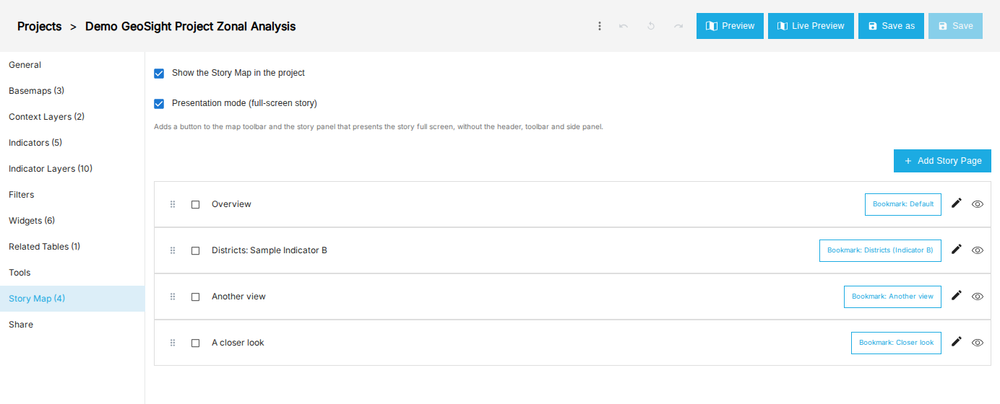
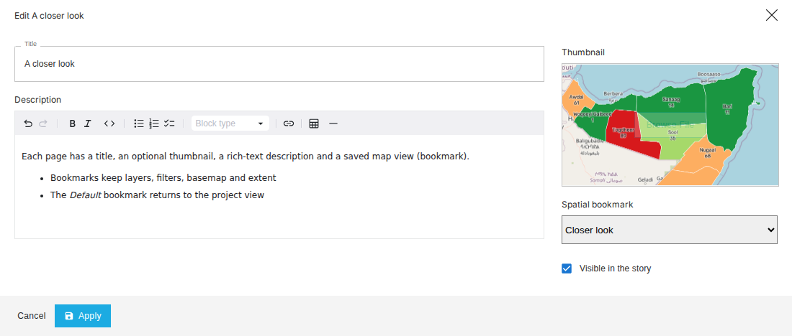
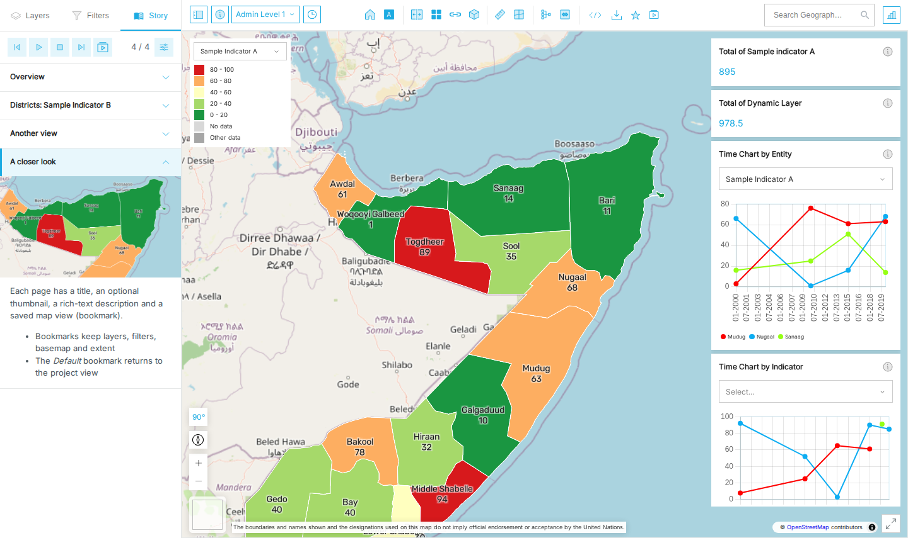
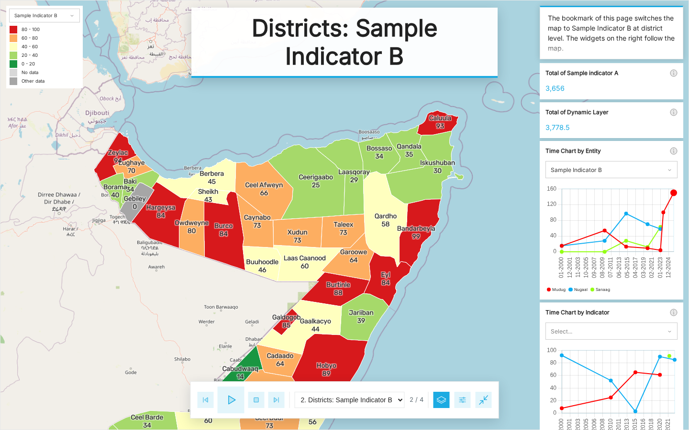
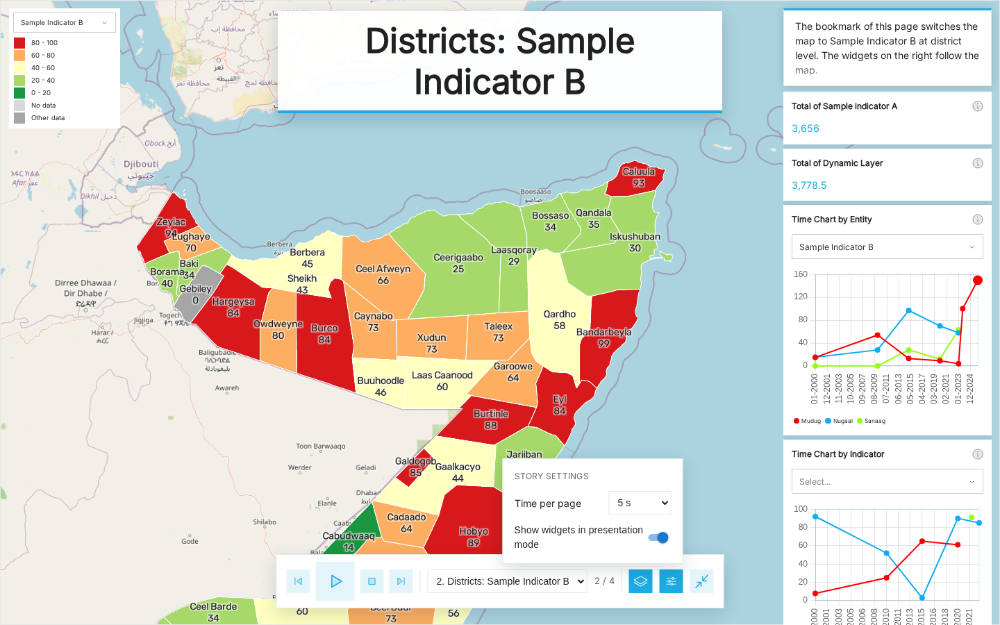
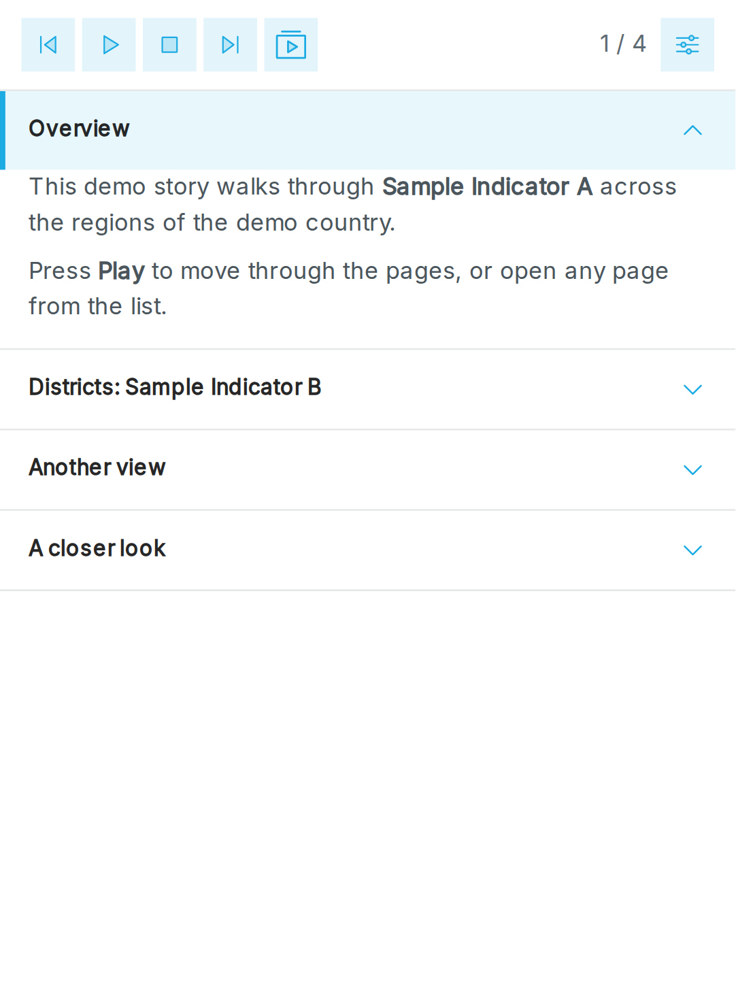
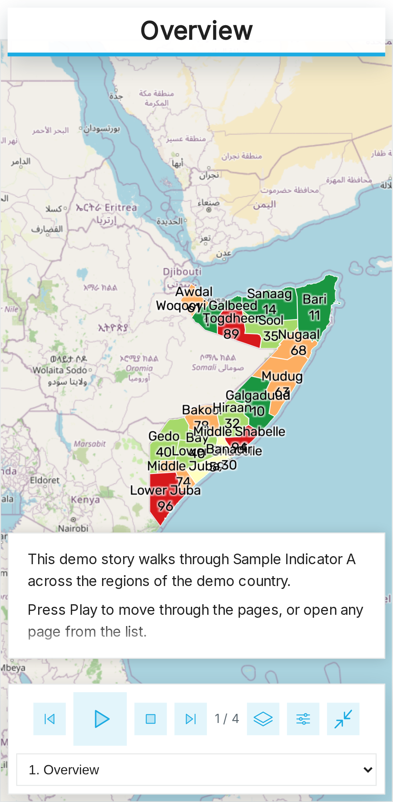

# Story Map

A Story Map is a guided narrative over the map of a project. It is a sequence of **story pages**. Each page has a title, an optional thumbnail, a description and a spatial bookmark. When a viewer opens a page, the map changes to the view saved in the bookmark (layers, filters, basemap and extent), and the widgets follow the map.

Viewers can go through the pages one by one or play the story, which moves to the next page automatically. Projects can also offer a full-screen **presentation mode**.

## Creating a Story Map

Story Maps are set up in the project editor, in the **Story Map** tab (between **Tools** and **Share**).

1. Create the [bookmarks](analysis-tools.md#bookmarks) you want to show, on the dashboard of the project. Each bookmark saves one view of the map. Bookmarks can only be created after the project is saved.
2. Open the project editor and the **Story Map** tab.
3. Tick **Show the Story Map in the project**. This adds the **Story** tab to the left panel of the dashboard.
4. Optionally tick **Presentation mode (full-screen story)**. This adds a presentation mode button to the map toolbar and to the story panel.
5. Click **Add Story Page** and fill in the page (see below).
6. Drag the pages by their handle to change their order. Use the eye icon to hide a page from the story without deleting it.
7. Click **Save** to save the project.

The button next to each page shows its bookmark. Use the pencil icon to edit a page. To delete pages, tick their checkboxes and click the delete icon.

### Story page settings

| Setting | Description |
|---|---|
| Title | Shown as the page title in the story panel and in presentation mode. |
| Description | Rich text: bold, italic, code, bulleted, numbered and check lists, headings (**Block type**), links, tables and horizontal lines. |
| Thumbnail | Optional image, shown in full above the description. |
| Spatial bookmark | The map view of the page. **Default** is the project's default view (its extent, layers and filters). If the bookmark is deleted later, the page stays in the story without a map view. |
| Visible in the story | Clear this to hide the page from the story. |

Click **Apply** to keep the changes, then **Save** the project.

## Viewing a Story Map

On the dashboard, open the **Story** tab in the left panel.

- Click a page title to open the page: the map moves to its bookmark. Only the current page is expanded. Use the arrow on the right of a title to show or hide a page's content without moving the map. Clicking the title of the current page again resets the map to its bookmark.
- The playback bar above the pages has these controls:

| Control | Action |
|---|---|
| Previous page / Next page | Opens the previous or next page. |
| Play / Pause | Plays the story: after the time per page, the next page opens. The story waits until the map data has loaded before it moves on. A progress bar shows the time left on the current page. |
| Stop | Stops playing and goes back to the first page. |
| Presentation mode | Opens the story in full screen (only if the project has presentation mode turned on). |
| Story settings | **Time per page** (3 to 20 seconds) and **Show widgets in presentation mode**. These settings are saved in the browser. |

The counter (for example **2 / 4**) shows the current page and the number of pages.

## Presentation mode

Presentation mode shows the story in full screen, like a slide show. The header, the map toolbar and the left panel are hidden. The page title is shown in large text at the top of the map, and the description is shown in a card at the top of the widget column, so the centre of the map stays free.

The bar at the bottom has the same controls as the story panel, plus:

- a page list, to jump to any page;
- **Show legend** / **Hide legend**, to show or hide the map legend;
- **Story settings**, where **Show widgets in presentation mode** shows or hides the widgets (the description card then sits in the upper-right corner);
- **Exit presentation mode**.

Long descriptions are shortened: click **More** to read the full text and **Less** to shorten it again.

Keyboard shortcuts in presentation mode:

| Key | Action |
|---|---|
| Right arrow | Next page |
| Left arrow | Previous page |
| Space | Play or pause |
| Esc | Exit presentation mode |

The up and down arrow keys do not move the map in presentation mode.

## On phones and small screens

On screens up to 1000 px wide, the story has its own **Story** tab at the bottom of the screen (see [The Dashboard page](dashboard.md#on-phones-and-small-screens)). Presentation mode also works on phones: the title is at the top, and the description and the playback bar are at the bottom. Widgets are not shown, and the legend is hidden until you turn it on.

| Story tab | Presentation mode |
|---|---|
| { width="300" } | { width="300" } |
